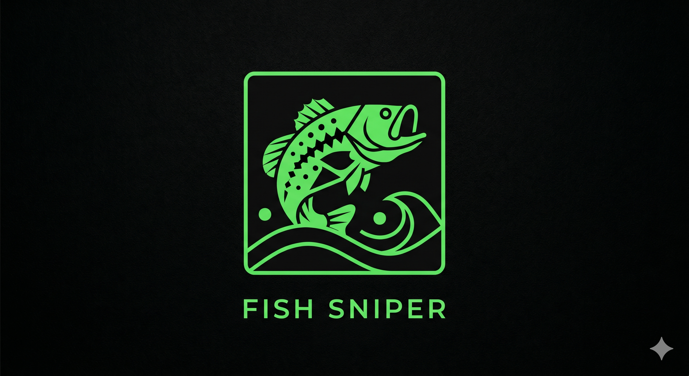

# FishSniper



> Auth-first rebuild in progress. Google identity is linked to an internal Supabase
> user, and the dashboard now includes hourly weather for freshwater fishing spots.

Live demo: https://fish-sniper.pages.dev | Backend: Railway | Frontend: Cloudflare Pages

---

## What works now

1. Sign in with Google (authorization code + PKCE).
2. Backend exchanges the code at `POST /auth/google/exchange` and verifies the Google `id_token`.
3. Backend upserts a `users` row by `google_sub` and signs a FishSniper JWT whose `sub` is the internal user UUID.
4. Protected routes validate `Authorization: Bearer <token>` and load the current user from Supabase.
5. The signed-in dashboard calls `GET /api/v1/me` to validate the saved session.
6. One Open-Meteo request supplies the daily weather summary, air temperature and
   pressure charts, and an hourly table with rain probability, wind and gusts.

---

## Tech stack

| Layer | Choices |
|-------|---------|
| Frontend | React 19, TypeScript, Vite, Tailwind CSS 4, React Router, Recharts |
| Backend | Python 3.11, FastAPI, Pydantic v2 |
| Data | Supabase Postgres + Data API (backend-only secret key) |
| Auth | Google OAuth 2.0 + PKCE (server-side token exchange + JWKS) |
| Infra | Railway (backend), Cloudflare Pages (frontend) |

---

## Project structure

```txt
backend/
  app/
    main.py         FastAPI app factory, middleware, router registration
    core/           Settings, security, errors, rate limiting, time
    auth/           Google OAuth exchange, JWT, auth schemas and routes
    db/             Supabase REST client, users repository, DB dependencies
    users/          Protected current-user API
    weather/        Hourly weather, location search, interchangeable cache
  tests/            pytest coverage for health, rate limiting, Google OAuth

frontend/
  src/
    app/            React app composition and routes
    auth/           Sign-in pages, auth UI, hooks, OAuth lib, auth API calls
    api/            Generic JSON HTTP client and common API envelope types
    config/         Public runtime environment readers
    i18n/           English/Traditional Chinese strings and language switcher
    users/          Current-user API and session validation hook
    dashboard/      Rebuilt tactical dashboard baseline
    weather/        Location picker, hourly weather loading and area charts

supabase/
  migrations/       Database schema migrations
```

---

## Frontend languages

The UI supports English (`en`) and Traditional Chinese (`zh-TW`) with i18next and
react-i18next. `frontend/src/i18n/translations.ts` contains matching translation keys
for both languages; components display them with `useTranslation()` and `t('key')`.
For dynamic text, pass variables such as `t('dashboard.signedInAs', { email })`.

The first visit follows the browser language (`zh*` selects Traditional Chinese;
otherwise English). A manual selection is saved as `fishsniper.language` in browser
`localStorage` and survives reloads in that browser. This is a frontend preference only:
it does not change Google OAuth, the JWT, Supabase user data, or API response language.

If an existing Docker development container uses the persistent `frontend_node_modules`
volume, install the new packages into that volume with
`docker compose -f docker-compose-dev.yaml run --rm --no-deps frontend npm ci` before
restarting the frontend.

## Weather forecasts

After signing in, allow browser location access or search for a place manually. The
dashboard offers today and the next six Taiwan-calendar dates. Weather comes from
[Open-Meteo](https://open-meteo.com/) and contains hourly forecast values, not live
observations. Air temperature and sea-level pressure are shown in two vertically
stacked area charts under a collapsed-by-default trend disclosure. Opening charts
does not fetch weather again. Air temperature uses a warm orange line and a zero-based Y axis
(which expands below zero for sub-zero forecasts); pressure uses a cyan line and
an automatic Y-axis range. Both curves have a translucent matching fill.
Charts use 24-hour time labels every two hours in wide containers and every four hours
in narrow containers; all hourly points remain available in tooltips. Four summary cards
show the day's most severe forecast condition, temperature range, highest hourly
rain probability and maximum wind/gust speeds. The horizontally scrollable hourly
table defaults to weather icons, air temperature, rain probability and wind speed.
A "more metrics" button reveals wind direction, gusts and pressure using the same
response. Weather names support English and Traditional Chinese;
clear-weather icons reflect day/night, missing values display a dash, and wind speeds
are normalized to m/s. Daily and hourly fields are fetched together, cached as one
response, and shared by all three UI sections through one loading hook.
The dashboard owns the selected location, date and forecast state. Desktop puts
weather and the larger water/spot preview on the left and strategy on the right;
mobile stacks summary, strategy, weather details and map. Recent logs sit below.
Desktop navigation sticks to the top, and mobile navigation stays at the bottom
with safe-area spacing. Overview, spots, strategy and logs navigate to real homepage
sections, not separate feature pages. Account details and sign-out are in the header
account menu. The AI, map and log panels are clearly labelled previews with unavailable
actions disabled; they do not display invented scores or catch probabilities.

Both weather APIs require a FishSniper Bearer token:

- `GET /api/v1/weather/hourly?lat=25.15&lon=121.79&date=YYYY-MM-DD`
- `GET /api/v1/weather/locations/search?q=Keelung&language=en`

The backend uses an in-process TTL cache behind a replaceable interface. Weather
results expire after 30 minutes by default. A backend restart clears the cache. JWT expiry and forecast
cache expiry are independent. Set the optional timeouts and TTLs in `backend/.env`.
Open-Meteo's free API is for non-commercial use; review its
[terms](https://open-meteo.com/en/terms) before commercial deployment.

---

## Local setup (short)

Copy `backend/.env.example` to `backend/.env` and `frontend/.env.example` to
`frontend/.env`, fill Google OAuth + Supabase + JWT values, then apply
`supabase/migrations/202609240001_create_users.sql` to the target Supabase project.

Existing local environments using `JWT_SECRET` and `SUPABASE_SERVICE_ROLE_KEY` remain
supported during migration. New environments should use `JWT_SECRET_KEY` and
`SUPABASE_SECRET_KEY`.

```bash
# backend
cd backend && uv sync --all-groups && uv run uvicorn app.main:app --reload

# frontend
cd frontend && npm ci && npm run dev
```

CI: `.github/workflows/ci.yml` runs backend lint/tests and frontend build.

### Docker Desktop

After creating `backend/.env` and `frontend/.env`, start the development containers:

```bash
docker compose -f docker-compose-dev.yaml up --build
```

Open the frontend at `http://localhost:5173`; the backend health endpoint is
`http://localhost:8000/health`. Source directories are mounted into both containers,
so Vite and Uvicorn reload after local code changes.

Run all checks in disposable containers:

```bash
docker compose -f docker-compose-dev.yaml --profile test run --rm backend-lint
docker compose -f docker-compose-dev.yaml --profile test run --rm backend-test
docker compose -f docker-compose-dev.yaml --profile test run --rm frontend-build
```

Stop the development environment with `docker compose -f docker-compose-dev.yaml down`. Add `--volumes` only
when you intentionally want to recreate the container-managed Python and Node dependency
volumes.

The Docker environment connects to the Supabase project configured in `backend/.env`.
A standalone PostgreSQL container is not included because the backend currently uses the
Supabase Data API rather than a direct PostgreSQL connection.
