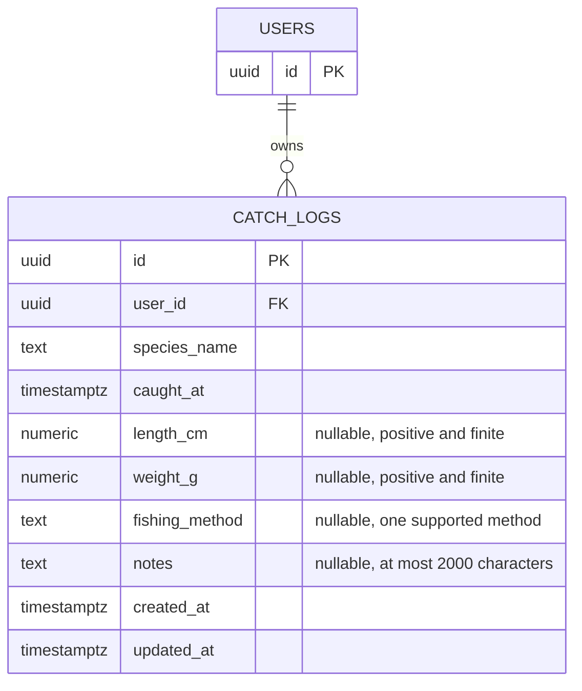

# Catch logs — Phase 2B

## Scope

One record represents one fish, private to its signed-in owner. Species and catch
time are required. Length in centimetres, weight in grams, one fishing method and
notes are optional. No public feed or shared catch map is planned.

This phase implements real persistence, not demo data. It does not create photo,
waterbody or fishing-spot tables. Location selection will be via a map, never by
requiring a user to type coordinates. Whether location is required remains open.
Later phases will support up to two photos, including HEIC input. Photo order is
called `photo_order`, distinct from geographic position; it is not implemented yet.

## Current schema



`created_at` and `updated_at` are database-managed; a trigger maintains update time.
The `(user_id, caught_at desc, id desc)` index supports owner-scoped page queries.
Fish names are free text for now; no species taxonomy database is introduced.
Fishing method codes are `lure`, `front_strike` (前打), `bottom`, `hand_pole`,
`fly_fishing`, and `other`. Labels are translated in the frontend. For other
methods, users can explain in the optional notes.

## API

| Method | Path | Success |
| --- | --- | --- |
| POST | `/api/v1/catch-logs` | 201, complete record |
| GET | `/api/v1/catch-logs?limit=10&offset=0` | 200, paginated records |
| GET | `/api/v1/catch-logs/{id}` | 200, complete record |
| PATCH | `/api/v1/catch-logs/{id}` | 200, complete updated record |
| DELETE | `/api/v1/catch-logs/{id}` | 204, no body |

Minimal create body:

```json
{
  "species_name": "大口黑鱸",
  "caught_at": "2026-10-20T07:30:00+08:00"
}
```

Explicit `null` clears optional fields in PATCH; omitted fields are untouched.
Empty patches, blank species, naive timestamps, nonpositive/nonfinite sizes,
unknown methods and unknown/system fields are rejected with 422. The initial
version does not impose an additional rule forbidding future catch timestamps.

All endpoints require the existing JWT/current-user dependency. Supabase access
remains backend-only. RLS is enabled, but the service-role credential bypasses it,
so every lookup/write/delete includes `user_id` in the same database operation.
404 intentionally does not distinguish missing from another owner's record.
Database/network failures return safe 503 responses and category logs, not secrets.

The frontend uses ten records per page; the API defaults to 20, capped at 100.
Ordering is `caught_at desc, id desc`; `has_more` is computed by fetching one extra
row. Offset pagination can shift under concurrent changes. After mutations the UI
reloads page one. Concurrent edits are last-write-wins in this prototype; no edit
versioning or conflict resolution is claimed.

## Implementation

- Repositories live in their owning feature: `users/` and `catch_logs/` each own
  their concrete `supabase_repository.py`, schemas and dependency wiring.
  Services accept the concrete Supabase repository via their constructor; the
  separate repository Protocol files have been removed. Dependency injection remains.
  `db/` contains only shared transport and database errors, not feature repositories.
- Backend: router → service → `SupabaseCatchLogsRepository` → existing REST client.
- Frontend: dashboard panel → catch-log workspace → list/detail hooks and API helpers.
- One shared form handles create/edit. Pending writes lock controls and reject
  duplicate clicks. Failed writes preserve entered values, and delete requires
  explicit confirmation. Errors, empty/loading states, and pagination are bilingual.
- Device-local catch times are converted to an explicit instant before sending.
  This is independent of the weather feature's Taiwan-calendar forecast dates.

## Applying and checking

Apply `202610200001_create_catch_logs.sql` after the existing users migration.
Migrations are not applied automatically by Docker. No production data is used in
automated tests. The SQL checks in `supabase/tests/catch_logs.sql` are for a
disposable PostgreSQL instance with `anon`, `authenticated` and `service_role`
roles, where `service_role` has BYPASSRLS like Supabase. The checks roll back their
fixtures and verify explicit grants, constraints, the owner FK and timestamp trigger.

Backend tests exercise real routing, JWT validation, service and concrete REST repository
against an HTTP database double. They test two-user isolation, CRUD, pagination,
nullable PATCH, invalid input and safe provider failures. Frontend tests exercise
HTTP serialization/authentication, empty 204 handling and local-time conversion.

When photos arrive, database cascades will not delete Storage objects. Deletion
must gain an explicit file cleanup/retry workflow before photo uploads are enabled.
